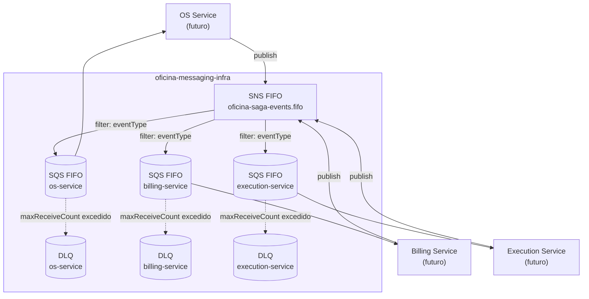

# oficina-messaging-infra

Infraestrutura como código (Terraform) para o broker de mensageria
assíncrona (**AWS SNS + SQS FIFO**) que conecta os microsserviços da Fase 4
do projeto **oficina** via Saga Pattern coreografado. Este é o
**Repositório 5**, criado na Sprint 1 da Fase 4, somando-se aos 4
repositórios da Fase 3:

| # | Repositório | Responsabilidade |
|---|---|---|
| 1 | oficina-db-infrastructure | Banco de dados gerenciado (RDS PostgreSQL) |
| 2 | oficina-lambda-auth | Lambda de autenticação por CPF + API Gateway |
| 3 | oficina-k8s-infrastructure | Cluster Kubernetes gerenciado (EKS) |
| 4 | oficina-app | Aplicação NestJS + observabilidade |
| 5 | **oficina-messaging-infra** (este) | Broker SNS/SQS do Saga + contratos de evento |

## Sumário

- [Propósito](#propósito)
- [Arquitetura](#arquitetura)
- [Contratos de evento](#contratos-de-evento)
- [Segurança](#segurança)
- [Execução local](#execução-local)
- [Execução via CI/CD](#execução-via-cicd)
- [Outputs](#outputs)

## Propósito

Provisionar um barramento de eventos único para o Saga Pattern coreografado
que vai conectar 3 microsserviços futuros (OS Service, Billing Service,
Execution Service — ainda não criados; ver
[`SAGA_PATTERN_SPEC.md`](../oficina-app/docs/SAGA_PATTERN_SPEC.md) no
`oficina-app`). Escolhido SNS+SQS (serverless) em vez de um broker próprio
(ex: RabbitMQ no K8s) para não reintroduzir custo fixo de cluster — o EKS da
Fase 3 foi destruído justamente para eliminar esse custo ocioso.

## Arquitetura



- **1 tópico SNS FIFO** (`oficina-saga-events.fifo`) para todos os 7 tipos
  de evento do Saga — evita criar um tópico por evento.
- **1 fila SQS FIFO + 1 DLQ por serviço consumidor**, cada uma inscrita no
  tópico com uma *filter policy* (`eventType`) que só entrega os eventos que
  aquele serviço precisa.
- **FIFO** (não *standard*) em todo o pipeline: `MessageGroupId =
  ordemServicoId` garante ordem de entrega por Ordem de Serviço — essencial
  num Saga, onde processar `ExecucaoIniciadaEvent` antes de
  `PagamentoAprovadoEvent` (por retry/entrega fora de ordem) corromperia o
  fluxo.

## Contratos de evento

Interfaces TypeScript e JSON Schemas dos 7 eventos (`OSCriadaEvent`,
`OrcamentoGeradoEvent`, `PagamentoAprovadoEvent`, `PagamentoRecusadoEvent`,
`ExecucaoIniciadaEvent`, `ExecucaoConcluidaEvent`, `CompensarOSEvent`) estão
em [`contracts/`](contracts/) — ver o [README](contracts/README.md) daquela
pasta para a tabela publicador/consumidor de cada evento e a convenção de
versionamento.

## Segurança

- Nenhum acesso público: a *resource policy* da fila SQS só permite
  `sqs:SendMessage` a partir do tópico SNS deste repositório (`Condition:
  aws:SourceArn`); a *topic policy* do SNS só permite ações do dono da conta.
- **Isolamento por serviço**: 3 IAM policies autônomas (`aws_iam_policy`,
  não roles, já que os repositórios dos serviços ainda não existem) —
  `oficina-saga-os-service-policy`, `-billing-service-policy`,
  `-execution-service-policy`. Cada uma só permite `sns:Publish` no tópico e
  `sqs:ReceiveMessage`/`DeleteMessage`/`GetQueueAttributes` na própria fila
  (+ leitura da própria DLQ para investigação). Nenhum wildcard de recurso.
  Quando os repositórios dos 3 microsserviços forem criados, a IAM Role de
  CI/runtime de cada um só precisa dar `attach` na policy correspondente
  (ver output `consumer_policy_arns`).
- **Criptografia**: SSE-SQS habilitada em todas as filas (gratuita).
- Nenhuma credencial de terceiro (ex: Mercado Pago) é gerenciada aqui — isso
  é responsabilidade do futuro repositório do Billing Service.

## Execução local

```bash
export AWS_PROFILE=terraform   # ou outro perfil com credenciais válidas
terraform init \
  -backend-config="bucket=oficina-tfstate-699372251061" \
  -backend-config="region=us-east-1" \
  -backend-config="dynamodb_table=oficina-db-terraform-locks"
terraform plan
terraform apply
```

Nenhuma variável sensível é necessária — ver `terraform.tfvars.example`.

## Execução via CI/CD

Pipeline em [`.github/workflows/terraform-messaging.yml`](.github/workflows/terraform-messaging.yml),
seguindo o mesmo padrão de 3 jobs dos demais repositórios de infraestrutura
da Fase 3 (`lint-validate` sempre, `plan` em PRs comentando o diff,
`apply` automático em push para `main`, atrás de um Environment
`production` com branch protection).

### Configuração necessária no GitHub

- **Secrets**: `AWS_ROLE_ARN` (IAM Role deste repositório, OIDC),
  `TF_STATE_BUCKET`, `TF_STATE_LOCK_TABLE`.
- Branch protection na `main` (`enforce_admins: true`,
  `required_approving_review_count: 0`), mesmo padrão adotado ao final da
  Fase 3.

## Outputs

| Output | Descrição |
|---|---|
| `sns_topic_arn` | ARN do tópico SNS FIFO único do Saga |
| `consumer_queue_urls` / `consumer_queue_arns` | URL/ARN de cada fila SQS FIFO (`os-service`, `billing-service`, `execution-service`) |
| `dlq_arns` | ARN de cada DLQ |
| `consumer_policy_arns` | ARN de cada IAM policy least-privilege, para os futuros repositórios de serviço |
